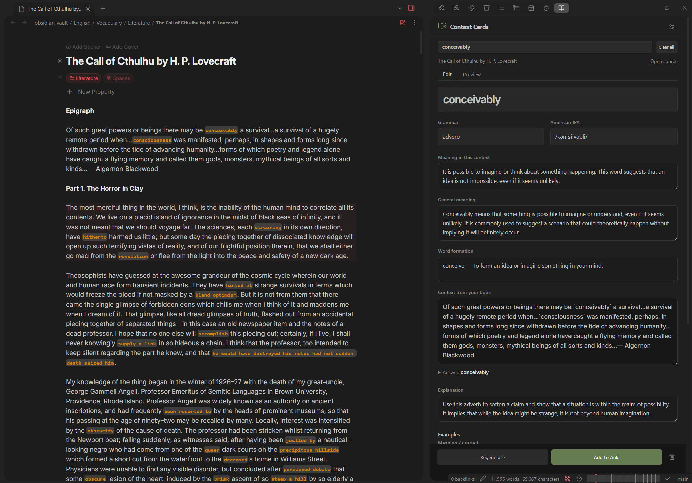

# Context Cards

**Learn the words you meet. Practise the mistakes you make.**

Turn your reading and writing into useful Anki practice, right inside Obsidian. Select a word to understand it, or select your own writing to find mistakes. Your local AI prepares the material; you review it before adding anything to Anki.

**[Get started — setup guide](docs/SETUP.md)** · **[Download](https://github.com/dmitriikuleshov/context-cards-obsidian/releases/latest)** · **[Interface walkthrough](docs/SETUP.md#4-explore-the-interface)**

## Two buttons, two ways to learn

| Select… | Click… | What happens next |
| --- | --- | --- |
| A word or expression in your Markdown reading | **Explain word / phrase** | Get an editable vocabulary draft with its context, meanings and examples. |
| A paragraph of your own English writing | **Find mistakes** | Review highlighted corrections and choose which ones to practise. |

Both actions open a draft first. You decide what goes into Anki.

## From a good book to a useful card

Collecting vocabulary should not mean copying passages between apps, writing every definition from scratch, or losing the context that helped a word make sense.

Context Cards brings that work into Obsidian:

1. **Select a word or expression** in your Markdown reading.
2. **Click Explain word / phrase.** A local model prepares an English draft from the surrounding passage.
3. **Review, edit, and add to Anki.** One approved note creates two complementary exercises.

No separate vocabulary notes to maintain. Your books stay in Obsidian; your spaced repetition stays in Anki.

## Turn writing mistakes into practice

Select your writing and click **Find mistakes**. Click a highlighted expression to inspect its correction, explanation and **Create an Anki card** checkbox. Keep the grammar and vocabulary corrections you want to practise, then choose **Review N cards** before exporting.

- **Correct the mistake:** repair a highlighted expression from your writing.
- **Fill in the gap:** restore a specific corrected form in a sentence.

**One selected correction creates one card.** Let the model choose an exercise type for each correction, or set your preference. Optional style suggestions, unclear meaning and spelling-only feedback do not become practice cards.

Exporting also saves a Markdown review with the original text, feedback and Anki references. Writing cards use their own deck. [Writing-mode walkthrough →](docs/SETUP.md#5-check-your-own-writing)

## Understand the word. Practise using it.

A definition is a start. A useful vocabulary card gives you more to work with:

- **Meaning in this context:** understand exactly what the word means in your passage.
- **General meaning:** connect that encounter to the word's broader use.
- **Grammar and pronunciation:** see the grammatical label and choose American or British IPA.
- **Word formation:** discover a useful base word and its meaning, without a long lesson on affixes.
- **Examples grouped by meaning or usage:** explore different established uses rather than five sentences saying the same thing.
- **Explanations and usage notes:** learn patterns, collocations and nuances that help you use the word yourself.

Every field is editable. Hide the fields you do not need, choose how much explanation you want, and set the number of example groups and sentences. Keep a compact reminder or build a fuller study note.

## Two ways to remember

| Exercise | What you practise |
| --- | --- |
| **Recognition** | See the word and recall its meaning. Reveal the original passage if you need a hint, then flip for the answer. |
| **Recall** | See your passage with a gap and type the missing word or expression. An optional definition hint helps when you get stuck. |

The recall exercise uses the **original source form**. If the book says “brushed off,” that is what you restore—even when the dictionary entry is “brush off.” Both exercises belong to one Anki note and stay in the same deck.

## Built around your reading

- **Read in either mode.** Capture selections from Reading Mode or Live Preview.
- **One familiar panel layout.** Both modes share the Context Cards header, a draft selector, **Clear all** and **Open source**.
- **Keep the source close.** Review the surrounding passage and jump back to the book.
- **Organise by book.** Use a separate subdeck for each Markdown file, or choose your own destination.
- **Check before exporting.** Preview both exercises and edit the draft before it reaches Anki.
- **Pick up where you left off.** The last four drafts in each mode can survive an Obsidian restart.
- **Mark words as you go.** Optionally format captured words as inline code in the source Markdown.
- **Review on your phone.** Sync the finished cards through Anki and study in AnkiDroid or AnkiMobile.

## Your model, on your computer

Context Cards uses **Ollama** to generate content and **AnkiConnect** to add approved notes. Both point to local addresses by default. There is no cloud fallback, telemetry, or AI subscription required by the plugin.

You choose the model and stay in control of the result. AI can still get meanings, pronunciation or examples wrong, so review is part of the workflow. If you configure a remote server, the relevant text is sent to that server instead.

## Choose a model for your study

**Start with Gemma 4 12B QAT** for the strongest overall results in our current plugin tests. **Qwen 3.5 9B** is a smaller option for everyday vocabulary capture and remains the plugin's default model.

| Tested Ollama model | When to choose it |
| --- | --- |
| [`gemma4:12b-it-qat`](https://ollama.com/library/gemma4:12b-it-qat) | Recommended starting point for both modes. Strong vocabulary examples and the best result in our expanded Find mistakes comparison. |
| [`qwen3.5:9b-q4_K_M`](https://ollama.com/library/qwen3.5:9b-q4_K_M) | The smallest download of these four; a good choice when compactness and quick vocabulary drafts matter. |
| [`gemma3:12b-it-q4_K_M`](https://ollama.com/library/gemma3:12b-it-q4_K_M) | An alternative for both modes. Improved usage examples, but word-formation suggestions need particular care. |
| [`qwen3:14b-q4_K_M`](https://ollama.com/library/qwen3:14b-q4_K_M) | An option to compare with the others. It was slower and showed no clear quality advantage for this workflow in our tests. |

These recommendations come from tests on Windows with an RTX 5070 (12 GB VRAM), 32 GB RAM and thinking disabled. They describe this plugin's tasks, rather than a general ranking of the models. Every model still made mistakes; correct corrections can also have inaccurate explanations.

**[Model downloads, comparison results and hardware advice →](docs/SETUP.md#choose-a-model)**

## Start with your next chapter

You will need **Obsidian Desktop**, **Ollama with a downloaded model**, and **Anki Desktop with AnkiConnect**. Windows is currently tested; actual app use on macOS and Linux has not been verified. Mobile Anki can review synced cards; mobile Obsidian is not supported.

Install through **BRAT** for convenient plugin updates, or download a ready-to-use ZIP. You do not need to build the plugin yourself.

**[Follow the setup guide →](docs/SETUP.md)**

The guide covers downloading the plugin, setting up Ollama and Anki, and a screenshot walkthrough of the interface.

---

For contributors: [testing](docs/TESTING.md) · [release instructions](docs/RELEASING.md) · [development history](docs/DEVELOPMENT-HISTORY.ru.md).

American pronunciation data is derived from CMUdict. See [data/README.md](data/README.md) and [its license](data/CMUDICT-LICENSE.txt); the notice is included in the downloadable ZIP.
