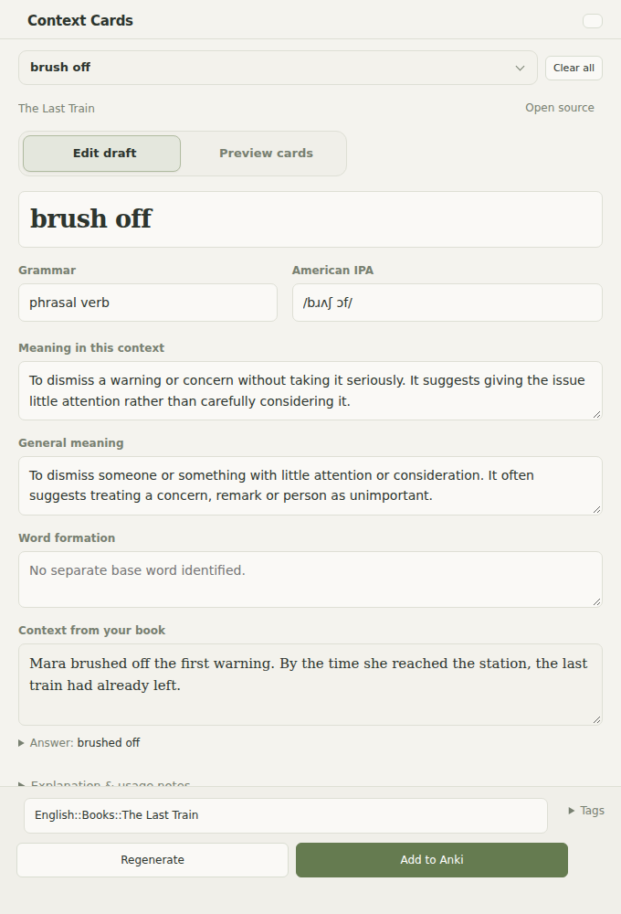
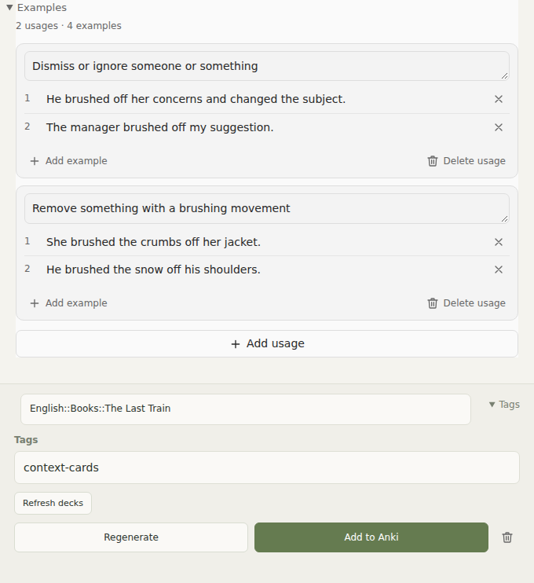
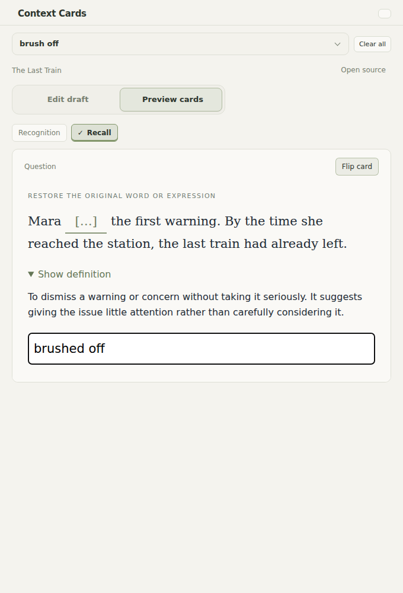
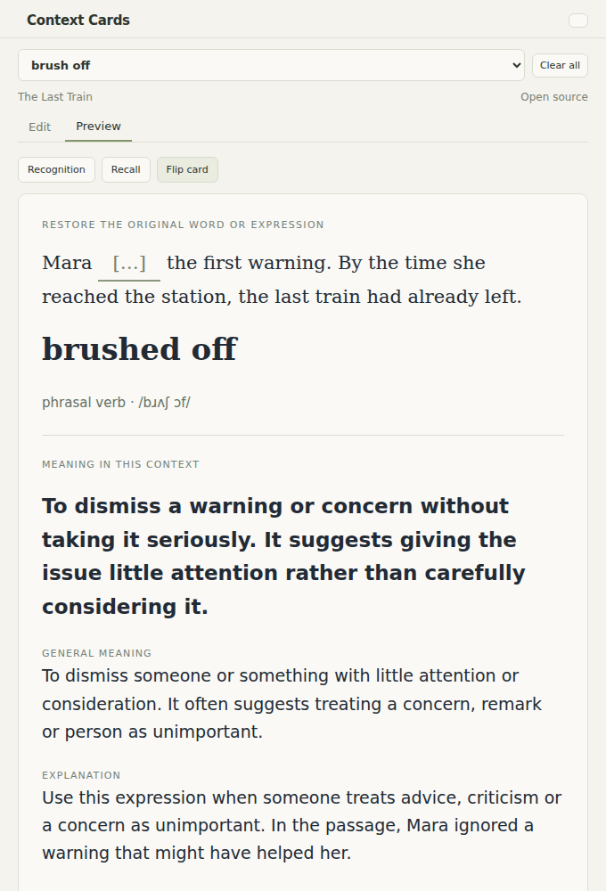

# Context Cards: setup and interface guide

This guide covers a first setup on Windows. You need three running applications: **Obsidian** for reading, **Ollama** for local generation, and **Anki Desktop** for adding cards. BRAT installs and updates the Obsidian plugin; it does not install Ollama or Anki.

1. [Download and install](#1-download-and-install)
2. [Set up Ollama](#2-set-up-ollama)
3. [Set up Anki](#3-set-up-anki)
4. [Explore the interface](#4-explore-the-interface)
5. [Check your own writing](#5-check-your-own-writing)

## 1. Download and install

### Recommended: BRAT

1. Open the intended vault in Obsidian.
2. Go to **Settings → Community plugins → Browse**. Enable community plugins first if they are disabled.
3. Find **BRAT**, select **Install**, then **Enable**.
4. Open BRAT settings and choose **Add beta plugin**.
5. Enter this repository:

   ```text
   dmitriikuleshov/context-cards-obsidian
   ```

6. Select the latest available version and add the plugin. Enable **Context Cards** under Community plugins if it is not enabled automatically.
7. Open **Settings → Context Cards**.

Configure update checks in BRAT, or use its update command. Do not uninstall Context Cards before updating: keep its settings and drafts in place.

### Alternative: ZIP

1. Open [the latest release](https://github.com/dmitriikuleshov/context-cards-obsidian/releases/latest).
2. Under **Assets**, download **context-cards-VERSION.zip**. Do not use the automatic **Source code** archives: they do not contain the compiled plugin.
3. Extract the `context-cards` folder into `<your vault>/.obsidian/plugins/`. Create `plugins` if necessary.
4. Check the result: `.obsidian/plugins/context-cards/main.js`, without another nested `context-cards` folder.
5. Restart Obsidian and enable **Context Cards** under Community plugins.

To update manually, disable the plugin, replace `main.js`, `manifest.json`, `styles.css` and the included documentation/CMUdict notice, then enable it again. **Keep your existing data.json**, which stores settings and drafts. No Node.js, npm or Python is needed to install a release.

## 2. Set up Ollama

### Install the application and model

1. Download [Ollama for Windows](https://ollama.com/download/windows), install it and start it.
2. Open **PowerShell** or **Windows Terminal** from the Start menu. Open a new terminal if it was already running before installation.
3. Download the default model:

   ```powershell
   ollama pull qwen3.5:9b-q4_K_M
   ```

4. Wait for the download to finish. The model requires several gigabytes of disk space, plus sufficient memory to run. Speed depends on hardware; the development setup uses an RTX 5070 and 32 GB RAM.
5. Check installed models:

   ```powershell
   ollama list
   ```

   The list should include `qwen3.5:9b-q4_K_M`.

Keep Ollama running while generating drafts. The Windows app normally starts its server itself; you do not need another `ollama serve` process when it is already running.

### Connect from Obsidian

Under **Settings → Context Cards → Local model**, start with:

| Setting | Value |
| --- | --- |
| Ollama server | `http://127.0.0.1:11434` |
| Model | `qwen3.5:9b-q4_K_M` |
| Generation temperature | `0.2` |
| Request timeout | `60 seconds` |

Click **Check connection** in the **Check Ollama** row. You should see a list of installed models. This only checks connectivity; it does not load the model or confirm that enough memory is available.

The first request may take longer while the model loads. Request timeout accepts a whole number of seconds; the default is `60`. For slower hardware, try `300` or `600`. You can use another installed model, but output quality and adherence to the requested format may differ.

With the default address, generation stays on your computer. Changing the Ollama URL sends the selected text and context to that server instead.

## 3. Set up Anki

### Install Anki Desktop and AnkiConnect

1. Install [Anki Desktop](https://apps.ankiweb.net/) and open it.
2. Choose **Tools → Add-ons → Get Add-ons**. Menu names may vary with the application language.
3. Enter the AnkiConnect add-on code:

   ```text
   2055492159
   ```

4. Confirm installation and restart Anki. See [AnkiConnect's official add-on page](https://ankiweb.net/shared/info/2055492159).
5. Keep Anki Desktop open while sending cards. A mobile Anki installation alone cannot receive notes from this plugin.

### Connect from Obsidian

Under **Settings → Context Cards → Anki**, start with:

| Setting | Value |
| --- | --- |
| AnkiConnect server | `http://127.0.0.1:8765` |
| AnkiConnect API key | Empty, unless you configured a key in AnkiConnect |
| Default deck | `English::Books` |
| One deck per book | On |
| Note type | `Context Cards` |

Click **Check connection** in the **Check Anki** row. The result should report the number of decks. Checking does not create decks or notes.

You do not need to create the destination deck or note type manually: the plugin creates them during the first approved export. By default, each Markdown file gets its own subdeck. For example, `The Call of Cthulhu.md` uses `English::Books::The Call of Cthulhu`.

### Verify your first note and sync

1. Open a Markdown text in Obsidian, select a word and click **Explain word / phrase**.
2. Review the generated draft and click **Add to Anki** in **Edit**.
3. After **Two cards added to Anki**, select **Open in Anki**, or open Anki's Browse window.
4. Check both **Recognition** and **Recall**. They are two cards from one note, not two independent notes.

For phone reviews, sync Anki Desktop with your AnkiWeb account, then sync AnkiDroid or AnkiMobile. Generation and export happen on the computer; the phone reviews the resulting cards. Consider enabling **Bury siblings** in Anki to separate the two exercises.

## 4. Explore the interface

The screenshots below show the **actual plugin panel in its standalone preview**, using sample content and simulated connections. They are not screenshots of the surrounding Obsidian window. Your Obsidian theme and panel width may change its appearance.

### Select a word and manage drafts

Read Markdown in **Reading Mode** or **Live Preview**, select a word or expression, and click **Explain word / phrase**. You can also use the Context Cards commands in Obsidian's command palette.

The panel opens with an editable draft. Use the selector at the top to switch between the latest **four** drafts. Adding a fifth removes the oldest from the list. **Clear all** clears drafts and cancels current generation; it does not delete Anki notes. Unsent content in removed drafts is lost.

### Edit: the word and its meanings



All teaching fields are in English and can be edited. Fields disabled in settings are hidden.

| Field | Purpose |
| --- | --- |
| Word or expression | Dictionary form of the selected item; it may differ from its source form. |
| Grammar | A grammatical label, such as `plural noun` or `phrasal verb`. |
| American IPA / British IPA | Pronunciation of the displayed dictionary entry. Choose the accent in settings. |
| Meaning in this context | The source-specific definition, also used as the hidden Recall hint. |
| General meaning | The broader definition without reference to the source passage. |
| Word formation | A useful base word and its general definition, without explaining affixes. It can be empty. |
| Context from your book | The source passage surrounding the selected occurrence. |
| Explanation | Usage and nuances of the selected source sense. |
| Examples | Editable meaning/usage groups, with example sentences in each. One group is enough for a word with one useful sense. |
| Usage notes | Short collocations, patterns or other useful nuances. |

### Context and the expected answer


**Answer** is the exact source form required by Recall. For example, the dictionary entry can be `brush off`, while the expected answer is `brushed off`.

If the answer is wrong, expand **Answer**, highlight the correct text inside the context field, then click **Use selection as answer**. It changes the expected answer to your selection. **More context** expands the passage from the captured source snapshot. You can also edit the context manually and regenerate for the updated passage.

### Explanation, examples, destination and actions

**Explanation & usage notes** appears above **Examples**. Both sections are collapsed initially; click their headings to expand and edit the fields. Their expanded state is kept when the panel redraws.



Edit each **Meaning / usage** heading and its examples. The model selects the number of groups within your configured limit; different topics alone do not necessarily represent different meanings.


Choose **Deck** in the footer above the action buttons. Expand **Tags** to edit tags or access **Refresh decks**. **Refresh decks** reloads the available deck names from Anki. After renaming a deck, select its new name yourself: the current destination is not remapped automatically.

- **Generate draft / Regenerate:** generate teaching content. For a proposed replacement, choose **Apply new version** or **Keep my draft** to retain your current edits.
- **Add to Anki:** export the approved note. Required enabled fields and a valid source answer must be present.
- **Trash icon:** discard the current draft; it does not delete an exported Anki note.

Review the result before approval: a local model can still produce incorrect definitions, pronunciation, grouping or example sentences.

### Preview: Recognition


Choose **Recognition** to see the word-first exercise. **Show context** reveals the source passage when context is enabled. **Flip card** shows the answer fields.

### Preview: Recall



Choose **Recall** to see the original passage with a gap. **Show definition** reveals the contextual meaning when enabled. Type the exact original source form, not necessarily the dictionary form in the draft heading.

The preview input demonstrates the exercise. Actual typed-answer comparison happens in Anki during review.

### Preview: the answer



**Flip card** switches between question and answer. Enabled teaching fields appear on the back. Preview has no generation/export footer: return to **Edit** to regenerate or add the note.

### Settings that change the panel

Dropdowns in both panels and settings use themed Obsidian menus, with a checkmark beside the current choice. Click a field or use Enter/Space or the arrow keys to open its menu; use Escape to close it without changing the value. Long labels wrap in the menu. Deck suggestions also follow the theme, and you can still type a new deck name.

Under **Settings → Context Cards → Card fields**, toggle fields, select the IPA accent, choose sentence counts and set example-group limits. Regenerate and apply a new version to change counts or accent in an existing draft. Simply disabling a field hides it without erasing its current text. Exported Anki notes are not regenerated.

Disabling **Context from your book** hides ordinary context display, but preserves the gapped passage in Recall. Disabling **Meaning in this context** removes the hidden definition hint.

**Reading workflow** controls the selection button, draft restoration and **Mark selected word as inline code**. Source marking wraps the selected word in backticks in the original Markdown when creating cards; it is off by default.

**Reset to defaults**, at the bottom of settings, resets all settings, including connections and remembered deck assignments. Drafts and Anki notes are kept.

### Troubleshooting

| Symptom | Check |
| --- | --- |
| No Explain word / phrase button | Markdown selection, Reading Mode/Live Preview and Selection button setting. Try the command palette. |
| Plugin missing | Enable it under Community plugins; for ZIP installation, check folder nesting. |
| Ollama unavailable | Running app, server URL and exact tag from `ollama list`. |
| Slow or failed generation | Initial model load, available memory and timeout. Connectivity checks do not test memory capacity. |
| Anki unavailable | Running Anki Desktop, installed AnkiConnect, URL and API key. |
| Add to Anki disabled | The message below Edit, enabled required fields, source answer, pending replacement or duplicate warning. |

Official references: [Ollama on Windows](https://docs.ollama.com/windows), [AnkiConnect](https://ankiweb.net/shared/info/2055492159), [Anki sync](https://docs.ankiweb.net/syncing.html), [BRAT](https://github.com/TfTHacker/obsidian42-brat).

## 5. Check your own writing

Writing practice is a separate mode. Existing vocabulary capture still works with **Explain word / phrase**.


1. Select a paragraph of your own English writing in Reading Mode or Live Preview, up to **6,000 characters**.
2. Click **Find mistakes** beside the selection, or run **Context Cards: Find mistakes** from the command palette. There is also a context-menu entry.
3. Click a highlighted word in **Original text** to inspect its correction and explanation. The original note is never automatically corrected or marked by this mode.
4. Beside **Edit**, the **Create an Anki card** checkbox controls whether this correction is included in the batch. Grammar and vocabulary corrections are checked by default after analysis; optional style, unclear meaning and typos stay unchecked. Uncheck any card you do not want. The label stays the same and the current word stays open. Saved choices are preserved when reopening a review. Exercises are prepared only when you click **Review N cards** below.
5. Click **Edit** to change a correction. Changes apply only after **Save changes**; **Cancel** discards them. **More details** contains the tip, issue metadata, exercise type and prepared card fields. Changing the underlying correction invalidates its exercise. Typing keeps focus.
6. Click **Review N cards** to prepare the selected exercises. Review their questions and answers together, then **Add N cards to Anki**. This saves the review and exports the batch. **← Corrections** returns to the original text without losing your choices; uncheck **Create an Anki card** there to exclude a correction. You can review your current selection before deciding on every suggestion.
7. The writing deck is always editable in the bottom panel, just like the deck in vocabulary mode. The panel stays at the bottom of the pane while your text and cards scroll above it. **Options**, beside the deck, expands **Recheck selection** within the same panel. The top uses the same Context Cards header as vocabulary mode, with a draft selector, **Clear all**, and a source row with **Open source**. When all corrections are excluded, **Finish review** completes the review without exporting cards.

Optional style, unclear meaning and obvious typos cannot become practice cards. If the meaning is unclear, resolve it yourself before classifying the finding as a definite grammar/vocabulary correction.

Invalid model responses get one automatic retry within your configured request timeout. Prepared cards and your choices are kept if another operation fails. Use **Retry preparing cards** after a preparation error. Cancelling a model request keeps earlier results and stays on corrections. Connection failures are shown without an automatic retry. If analysis keeps failing, try a shorter selection or increase **Request timeout** in Local model settings.

If exporting partly fails, the preview marks successful cards **Already added** and locks their editing controls. **Retry remaining cards** sends only the remaining exercises. The entire pending batch is validated before its first card is sent.

**One selected finding creates one card.** Correction cards ask you to repair the highlighted fragment; gap cards use Anki's typed-answer comparison. Hints are collapsed on the front. Treat the answer as a model answer: other natural wording can be valid, and Anki still lets you assess your own response.

The model uses the original sentence for the exercise and fixes other recognised, non-overlapping mistakes in that same sentence so there is one target to practise. Review the result: schema checks can verify that the question and answer agree, not that the English advice is always correct.

Analysis now checks proposed edits in a separate model pass before keeping them. Both passes share the configured analysis timeout. This can take a little longer. Card preparation keeps the checked explanation and tip, and source/preview headings show the actual replacement. Narrow grammar/vocabulary highlights take priority over overlapping optional suggestions. Whole-sentence inventions and corrections that combine separate targets are rejected. These checks reduce inconsistent feedback; they do not make a local model infallible.

Existing drafts keep their captured content. After updating, use **Options → Recheck selection** to replace an older, inconsistent analysis, then prepare its cards again. Rechecking is disabled for already-exported reviews; start a fresh selection in that case.

The editor keeps unsaved text, dropdown choices and cursor position during background redraws. **Cancel** discards those changes. Saving only prepared card fields returns directly to preview; changing the underlying correction returns to corrections so its exercise can be prepared again. The panel accounts for the footer when scrolling to controls. In short windows, the footer scrolls with the page instead of covering content.

### Writing settings and saved reviews

Under **Settings → Context Cards → Writing practice**:

| Setting | Default | Purpose |
| --- | --- | --- |
| English variant | `Accept both` | Accept standard American and British forms, or select one variant to check regional spelling too. |
| Check grammar | On | Check grammar, tense, agreement, punctuation and capitalization. |
| Check vocabulary and collocations | On | Check word choice and word combinations. |
| Check spelling | On | Include spelling feedback; spelling-only findings do not become practice cards. |
| Default exercise type | `Let AI choose` | Let the model choose a format per correction, or prefer Correct the mistake / Fill in the gap. Deletions always use correction cards. |
| Writing deck | `English::Writing mistakes` | Destination for writing exercises, separate from reading vocabulary. |
| Writing review folder | `English/Writing reviews` | Vault-relative folder for saved Markdown feedback. |
| Writing note type | `Context Cards Writing` | A separate note type with one Practice template. Keep it different from the vocabulary type. |

A saved review keeps the selected text, source link, suggestions, exercise drafts and exported Anki identifiers. It is created when exporting cards. Open it from your configured writing review folder or the source link in Anki. Personal notes appended after its managed review block are retained when the plugin updates the review.

Writing preferences apply to the next analysis or **Recheck selection**. Existing drafts and prepared cards keep their saved settings. You can override the exercise type for a specific correction under **Edit → More details → Exercise type** before preparing cards. Enable at least one check category to run an analysis.

The latest four writing sessions are stored with plugin data when **Restore unfinished drafts** is enabled. They are independent of the four vocabulary drafts. Rechecking replaces the session's suggestions and unexported exercise drafts; it is disabled after a finding has been exported. Use a fresh selection for new writing.

With multiple writing drafts, **Clear all** beside the selector clears every writing draft and cancels running analysis/preparation. With one draft, its title appears beside **Clear draft**. With no drafts, the panel shows **No writing drafts** and no clearing controls. Clearing keeps vocabulary drafts, saved review notes and existing Anki cards. It is disabled while a review is being saved or cards are being exported.

Successful exports show **Added to Anki**. A matching existing practice note can be reused, and retries skip findings already exported. Matching uses the normalised error/pattern key, not a complete semantic understanding of every equivalent mistake. An export interrupted halfway preserves successful note identifiers so you can retry the remaining cards.

Keep Ollama open while checking/preparing, and Anki Desktop open while exporting. Longer selections can take longer or exceed the local model's output capacity; split a large text into paragraphs if needed. A result with no findings means the model did not flag issues, not that the text is guaranteed error-free.
