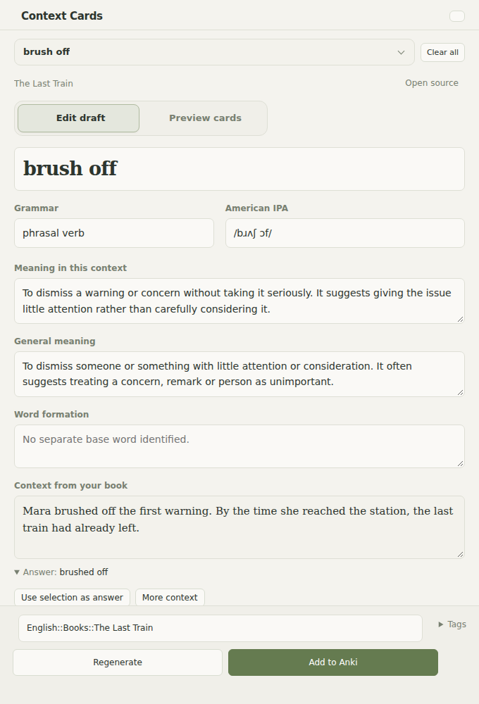
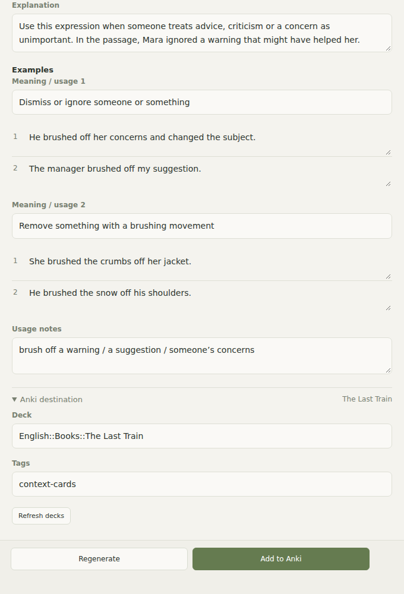
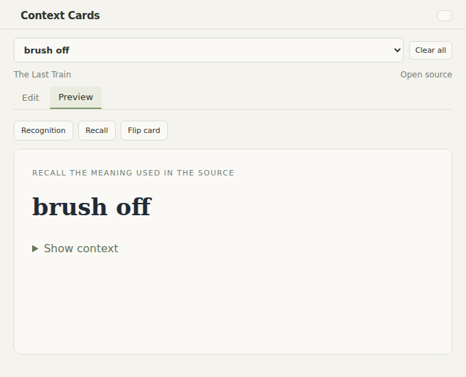
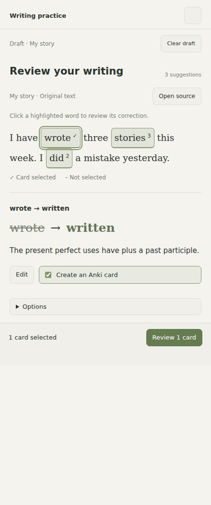
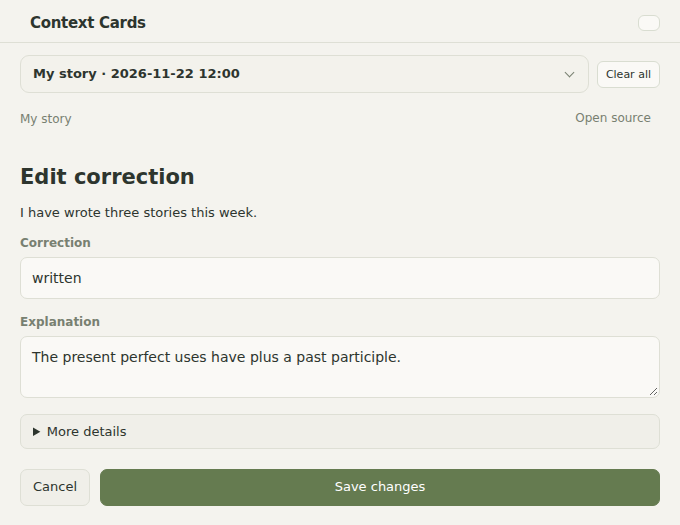
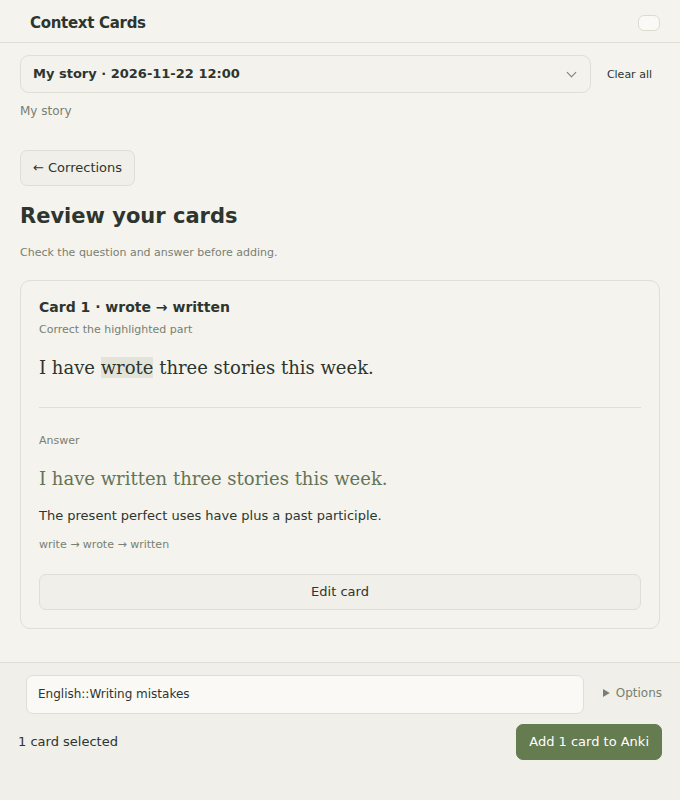

# Context Cards: setup and interface guide

Set up the plugin on Windows, connect a local model and Anki, then create your first vocabulary or writing card. Keep **Ollama** running while generating content and **Anki Desktop** running while exporting. BRAT installs the Obsidian plugin; Ollama and Anki are separate applications.

| Select… | Use… | Result |
| --- | --- | --- |
| One word or expression in your reading | **Explain word / phrase** | An editable vocabulary draft. |
| A paragraph of your own English writing | **Find mistakes** | Highlighted corrections to review. |

Both actions prepare material for review. Exporting to Anki is a later step.

1. [Download and install](#1-download-and-install)
2. [Set up Ollama](#2-set-up-ollama)
3. [Set up Anki](#3-set-up-anki)
4. [Explore the interface](#4-explore-the-interface)
5. [Check your own writing](#5-check-your-own-writing)

## 1. Download and install

### Recommended: BRAT

1. Open the intended vault in Obsidian.
2. Go to **Settings → Community plugins → Browse**. Enable community plugins first if they are disabled.
3. Find **BRAT**, select **Install**, then **Enable**.
4. Open BRAT settings and choose **Add beta plugin**.
5. Enter this repository:

   ```text
   dmitriikuleshov/context-cards-obsidian
   ```

6. Add the plugin using the latest published release. If a version selector is shown, choose the latest release. Enable **Context Cards** under Community plugins if needed.
7. Open **Settings → Context Cards**.

Configure update checks in BRAT, or use its update command. Keep your existing plugin settings and drafts in place. See [BRAT's documentation](https://tfthacker.com/BRAT) for its installation and update controls.

### Alternative: ZIP

1. Open [the latest release](https://github.com/dmitriikuleshov/context-cards-obsidian/releases/latest).
2. Under **Assets**, download **context-cards-VERSION.zip**. Do not use the automatic **Source code** archives: they do not contain the compiled plugin.
3. Extract the `context-cards` folder into `<your vault>/.obsidian/plugins/`. Create `plugins` if necessary.
4. Check the folder structure:

   ```text
   <your vault>/
     .obsidian/
       plugins/
         context-cards/
           main.js
           manifest.json
           styles.css
           CMUDICT-LICENSE.txt
           INSTALL.txt
   ```

   `main.js` must be directly inside `context-cards`, without another nested folder.
5. Restart Obsidian and enable **Context Cards** under Community plugins.

To update manually, disable the plugin, replace the release files in its existing folder, then enable it again or restart Obsidian. **Keep your existing `data.json`**, which stores settings, API key and drafts. No Node.js, npm or Python is needed to install a release.

## 2. Set up Ollama

### Install the application and model

1. Download [Ollama for Windows](https://ollama.com/download/windows), install it and start it.
2. Open **PowerShell** or **Windows Terminal** from the Start menu. Open a new terminal if it was already running before installation.
3. Download the default model:

   ```powershell
   ollama pull qwen3.5:9b-q4_K_M
   ```

4. Wait for the download to finish. The model requires several gigabytes of disk space and enough memory to run. Speed depends on the chosen model and your hardware.
5. Check installed models:

   ```powershell
   ollama list
   ```

   The list should include `qwen3.5:9b-q4_K_M`.

Keep Ollama running while generating drafts. Its Windows app runs the server in the background; an additional `ollama serve` process is unnecessary when it is already active. [Official Windows instructions](https://docs.ollama.com/windows)

### Connect from Obsidian

Under **Settings → Context Cards → Local model**, start with:

| Setting | Value |
| --- | --- |
| Ollama server | `http://127.0.0.1:11434` |
| Model | `qwen3.5:9b-q4_K_M` |
| Context length | `Balanced · 1,800 characters` |
| Generation temperature | `0.2` |
| Request timeout | `60 seconds` |

The **Model** list loads automatically from the configured Ollama server. Choose an installed model from the dropdown. After downloading or removing a model, click **Refresh** next to the list. Refreshing does not download or load models, generate a draft, or confirm that a model fits in memory. If your saved model is missing, it stays selected and is marked **not installed** until you explicitly choose another model. A connection failure also keeps your saved choice.

The first request may take longer while the model loads. Request timeout accepts a whole number of seconds; the default is `60`. For slower hardware, try `300` or `600`. You can use another installed model, but output quality and adherence to the requested format may differ.

With the default address, generation stays on your computer. Changing the Ollama URL sends the selected text and context to that server instead.

## 3. Set up Anki

### Install Anki Desktop and AnkiConnect

1. Install [Anki Desktop](https://apps.ankiweb.net/) and open it.
2. Choose **Tools → Add-ons → Get Add-ons**. Menu names may vary with the application language.
3. Enter the AnkiConnect add-on code:

   ```text
   2055492159
   ```

4. Confirm installation and restart Anki. See [AnkiConnect's official add-on page](https://ankiweb.net/shared/info/2055492159).
5. Keep Anki Desktop open while sending cards. A mobile Anki installation alone cannot receive notes from this plugin.

### Connect from Obsidian

Under **Settings → Context Cards → Anki**, start with:

| Setting | Value |
| --- | --- |
| AnkiConnect server | `http://127.0.0.1:8765` |
| AnkiConnect API key | Empty, unless you configured a key in AnkiConnect |
| Default deck | `English::Books` |
| One deck per book | On |
| Note type | `Context Cards` |

Click **Check connection** in the **Check Anki** row. The result should report the number of decks. Checking does not create decks or notes.

You do not need to create the destination deck or note type manually: the plugin creates them during the first approved export. By default, each Markdown file gets its own subdeck. For example, `The Call of Cthulhu.md` uses `English::Books::The Call of Cthulhu`.

### Verify your first note and sync

1. Open a Markdown text in Obsidian, select a word and click **Explain word / phrase**.
2. Review the generated draft and click **Add to Anki** in **Edit**.
3. After **Two cards added to Anki**, select **Open in Anki**, or open Anki's Browse window.
4. Check both **Recognition** and **Recall**. They are two cards from one note, not two independent notes.

For phone reviews, sync Anki Desktop with your AnkiWeb account, then sync AnkiDroid or AnkiMobile with the same account. Generation and export happen on the computer; the phone reviews the resulting cards. Anki's **Bury siblings** option can separate the two exercises. [Anki syncing instructions](https://docs.ankiweb.net/manual/syncing)

## 4. Explore the interface

The screenshots below show the **current plugin views in the standalone preview**, with sample text and simulated model/Anki connections. Your Obsidian theme and panel width affect their appearance. The README's opening image shows the plugin inside Obsidian.

### Select a word and manage drafts

Read Markdown in **Reading Mode** or **Live Preview**, select a word or expression, and click **Explain word / phrase**. You can also use the Context Cards commands in Obsidian's command palette.

Both modes share the **Context Cards** header and settings button, a **draft selector** with **Clear all**, and a source row with **Open source**. The selector appears even when there is one draft.

The latest **four** drafts in each mode can be restored across restarts. The two lists are independent. **Clear all** clears the current mode's drafts and cancels generation while keeping existing Anki notes. With no drafts, the selector and clearing controls disappear.

### Edit: the word and its meanings


All teaching fields are in English and can be edited. Fields disabled in settings are hidden.

| Field | Purpose |
| --- | --- |
| Word or expression | Dictionary form of the selected item; it may differ from its source form. |
| Grammar | A grammatical label, such as `plural noun` or `phrasal verb`. |
| American IPA / British IPA | Pronunciation of the displayed dictionary entry. Choose the accent in settings. |
| Meaning in this context | The source-specific definition, also used as the hidden Recall hint. |
| General meaning | The broader definition without reference to the source passage. |
| Word formation | A useful base word and its general definition, without explaining affixes. It can be empty. |
| Context from your book | The source passage surrounding the selected occurrence. |
| Explanation | Usage and nuances of the selected source sense. |
| Examples | Editable meaning/usage groups, with example sentences in each. One group is enough for a word with one useful sense. |
| Usage notes | Short collocations, patterns or other useful nuances. |

### Context and the expected answer



**Answer** is the exact source form required by Recall. For example, the dictionary entry can be `brush off`, while the expected answer is `brushed off`.

If the answer is wrong, expand **Answer**, highlight the correct text inside the context field, then click **Use selection as answer**. It changes the expected answer to your selection. If you change the learning target, regenerate and review its teaching content too. **More context** expands the passage from the captured source snapshot.

Vocabulary context supports up to **12,000 characters**: choose **Extended · 12,000 characters** in Local model settings for a larger surrounding-text budget. New drafts still start with the selected sentence and its neighbours; use More context to expand them. Longer contexts use a larger model window and may take more time and memory. The writing selection limit remains 6,000 characters.

### Explanation, examples, destination and actions

**Explanation & usage notes** appears above **Examples**. Both sections are collapsed initially; click their headings to expand and edit the fields. Their expanded state is kept when the panel redraws.


Edit each **Meaning / usage** heading and its examples. The model selects the number of groups within your configured limit; different topics alone do not necessarily represent different meanings.



Choose **Deck** in the footer above the action buttons. Expand **Tags** to edit tags or access **Refresh decks**. **Refresh decks** reloads the available deck names from Anki. After renaming a deck, select its new name yourself: the current destination is not remapped automatically.

- **Generate draft / Regenerate:** generate teaching content. For a proposed replacement, choose **Apply new version** or **Keep my draft** to retain your current edits.
- **Add to Anki:** export the approved note. Required enabled fields and a valid source answer must be present.
- **Trash icon:** discard the current draft; it does not delete an exported Anki note.

Review the result before approval: a local model can still produce incorrect definitions, pronunciation, grouping or example sentences.

### Preview: Recognition



Choose **Recognition** to see the word-first exercise. **Show context** reveals the source passage when context is enabled. **Flip card** shows the answer fields.

### Preview: Recall


Choose **Recall** to see the original passage with a gap. **Show definition** reveals the contextual meaning when enabled. Type the exact original source form, not necessarily the dictionary form in the draft heading.

The preview input demonstrates the exercise. Actual typed-answer comparison happens in Anki during review.

### Preview: the answer


**Flip card** switches between question and answer. Enabled teaching fields appear on the back. Preview has no generation/export footer: return to **Edit** to regenerate or add the note.

### Settings that change the panel

Dropdowns in both panels and settings use themed Obsidian menus, with a checkmark beside the current choice. Click a field or use Enter/Space or the arrow keys to open its menu; use Escape to close it without changing the value. Long labels wrap in the menu. Deck suggestions also follow the theme, and you can still type a new deck name.

Under **Settings → Context Cards → Card fields**, toggle fields, select the IPA accent, choose sentence counts and set example-group limits. Regenerate and apply a new version to change counts or accent in an existing draft. Simply disabling a field hides it without erasing its current text. Exported Anki notes are not regenerated.

Disabling **Context from your book** hides ordinary context display, but preserves the gapped passage in Recall. Disabling **Meaning in this context** removes the hidden definition hint.

**Reading workflow** controls the selection button, draft restoration and **Mark selected word as inline code**. Source marking wraps the selected word in backticks in the original Markdown when creating cards; it is off by default.

**Reset to defaults**, at the bottom of settings, resets all settings, including connections and remembered deck assignments. Drafts and Anki notes are kept.

### Troubleshooting

| Symptom | Check |
| --- | --- |
| No selection buttons | Select text in a Markdown note in Reading Mode or Live Preview. Enable **Reading workflow → Selection button**, or use the command palette. |
| Plugin missing | Enable it under Community plugins; for ZIP installation, check folder nesting. |
| Ollama unavailable | Running app, server URL and exact tag from `ollama list`. |
| Slow or failed generation | Initial model load, available memory and timeout. Connectivity checks do not test memory capacity. |
| Anki unavailable | Running Anki Desktop, installed AnkiConnect, URL and API key. |
| Add to Anki disabled | The message below Edit, enabled required fields, source answer, pending replacement or duplicate warning. |
| Old button names or duplicated controls | Update with BRAT or the latest ZIP, then restart Obsidian. |

Official references: [Ollama on Windows](https://docs.ollama.com/windows), [AnkiConnect](https://ankiweb.net/shared/info/2055492159), [Anki sync](https://docs.ankiweb.net/manual/syncing), [BRAT](https://tfthacker.com/BRAT).

## 5. Check your own writing

Use **Find mistakes** for your own writing and **Explain word / phrase** for vocabulary from your reading. The two modes have independent drafts and Anki destinations.

### Find and choose corrections

1. Select a paragraph of your own English writing in Reading Mode or Live Preview, up to **6,000 characters**.
2. Click **Find mistakes** beside the selection, or run **Context Cards: Find mistakes** from the command palette. There is also a context-menu entry.
3. Click a highlighted expression in the selected paragraph to read its correction and explanation. The original note is not automatically corrected or marked.
4. Use **Create an Anki card** to include or exclude that correction. Grammar and vocabulary corrections are selected by default. Selecting the checkbox does not export anything yet.



### Edit feedback or the exercise type

Click **Edit** to adjust the correction and explanation. Choose **Save changes** to apply your edits, or **Cancel** to keep the earlier version.



Under **More details**, you can change the exercise type or inspect other feedback fields. Choose **Correct the mistake** or **Fill in the gap** per correction. The default **Let AI choose** setting selects a format during generation. Changing the underlying correction requires preparing its exercise again.

### Review and export

1. Click **Review N cards** to prepare exercises for the corrections you selected.
2. Check each question and answer. **Edit card** opens the editor; **← Corrections** returns to the highlighted paragraph so you can change your selection.
3. Choose the writing deck in the bottom bar, then click **Add N cards to Anki**. Exporting also saves the Markdown review automatically.



**Options → Recheck selection** analyses the text again and replaces unexported suggestions and exercises. Rechecking is disabled after a finding has been exported; use a fresh selection for new work. When all corrections are excluded, **Finish review** completes the review without exporting cards.

Optional style, unclear meaning and obvious typos cannot become practice cards. If the meaning is unclear, resolve it yourself before classifying the finding as a definite grammar/vocabulary correction.

Invalid model responses get one automatic retry within your configured request timeout. Prepared cards and your choices are kept if another operation fails. Use **Retry preparing cards** after a preparation error. Cancelling a model request keeps earlier results and stays on corrections. Connection failures are shown without an automatic retry. If analysis keeps failing, try a shorter selection or increase **Request timeout** in Local model settings.

If exporting partly fails, the preview marks successful cards **Already added** and locks their editing controls. **Retry remaining cards** sends only the remaining exercises. The entire pending batch is validated before its first card is sent.

**One selected finding creates one card.** Correction cards ask you to repair the highlighted fragment; gap cards use Anki's typed-answer comparison. Hints are collapsed on the front. Treat the answer as a model answer: other natural wording can be valid, and Anki still lets you assess your own response.

The model uses the original sentence for the exercise and fixes other recognised, non-overlapping mistakes in that same sentence so there is one target to practise. Review the result: schema checks can verify that the question and answer agree, not that the English advice is always correct.

Saving only prepared card feedback returns to preview. Changing the underlying correction returns to corrections so you can prepare its exercise again.

### Writing settings and saved reviews

Under **Settings → Context Cards → Writing practice**:

| Setting | Default | Purpose |
| --- | --- | --- |
| English variant | `Accept both` | Accept standard American and British forms, or select one variant to check regional spelling too. |
| Check grammar | On | Check grammar, tense, agreement, punctuation and capitalization. |
| Check vocabulary and collocations | On | Check word choice and word combinations. |
| Check spelling | On | Include spelling feedback; spelling-only findings do not become practice cards. |
| Default exercise type | `Let AI choose` | Let the model choose a format per correction, or prefer Correct the mistake / Fill in the gap. Deletions always use correction cards. |
| Writing deck | `English::Writing mistakes` | Destination for writing exercises, separate from reading vocabulary. |
| Writing review folder | `English/Writing reviews` | Vault-relative folder for saved Markdown feedback. |
| Writing note type | `Context Cards Writing` | A separate note type with one Practice template. Keep it different from the vocabulary type. |

A saved review keeps the selected text, source link, suggestions, exercise drafts and exported Anki identifiers. It is created automatically when exporting cards; there is no separate Save review step. Open it from your configured writing review folder or the source link in Anki. Personal notes appended after its managed review block are retained when the plugin updates the review.

Writing preferences apply to the next analysis or **Recheck selection**. Existing drafts and prepared cards keep their saved settings. You can override the exercise type for a specific correction under **Edit → More details → Exercise type** before preparing cards. Enable at least one check category to run an analysis.

The latest four writing sessions are stored with plugin data when **Restore unfinished drafts** is enabled. They are independent of the four vocabulary drafts. Rechecking replaces the session's suggestions and unexported exercise drafts; it is disabled after a finding has been exported. Use a fresh selection for new writing.

**Clear all** appears beside the selector even with one writing draft. It clears writing drafts and cancels analysis/preparation while keeping vocabulary drafts, saved review notes and Anki cards. With no writing drafts, the selector and clearing button disappear. Clearing is disabled during saving or export.

Successful exports show **Added to Anki**. A matching existing practice note can be reused, and retries skip findings already exported. Matching uses the normalised error/pattern key, not a complete semantic understanding of every equivalent mistake. An export interrupted halfway preserves successful note identifiers so you can retry the remaining cards.

Keep Ollama open while checking/preparing, and Anki Desktop open while exporting. Longer selections can take longer or exceed the local model's output capacity; split a large text into paragraphs if needed. A result with no findings means the model did not flag issues, not that the text is guaranteed error-free.
